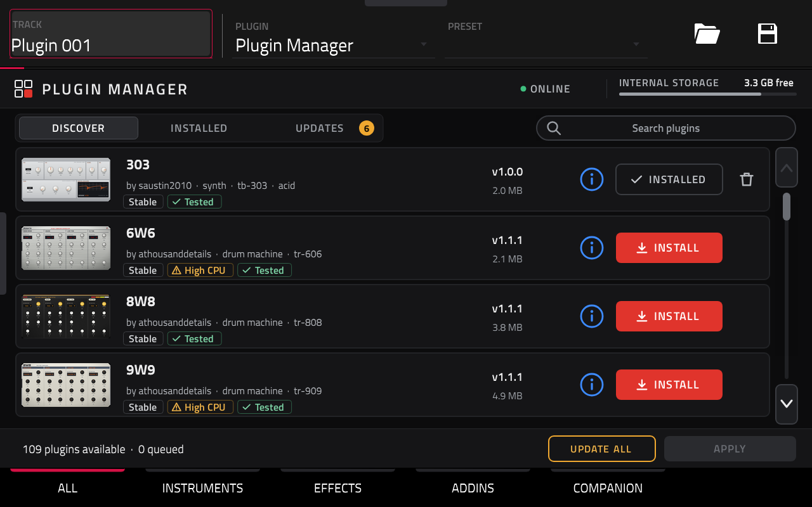
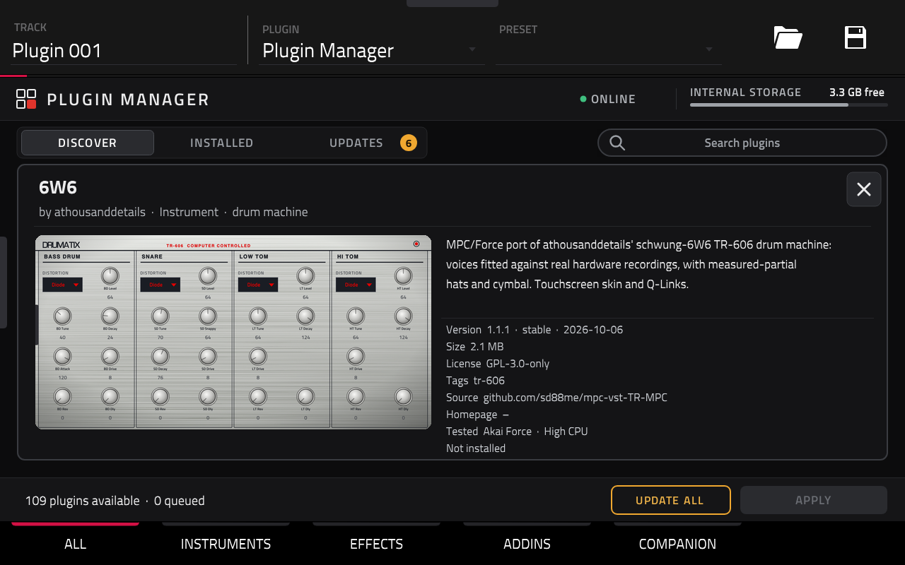

# Plugin Manager for MPC / Force

A VST2 "instrument" for the MPC OS plugin host that is really an app: it lists the
[mpc-vst-plugins catalog](https://sd88me.github.io/mpc-vst-plugins/) on the MPC screen and installs, updates and
removes plugins, with one MPC restart per batch. Working on an MPC One and an MPC Key 37 (Gen1, MPC OS 3.9.1).





## Using it
1. Add **Plugin Manager** to a plugin track. It loads the catalog and reads what is installed.
2. The MPC tabs at the bottom are the categories: **ALL**, **INSTRUMENTS**, **EFFECTS**, **ADDINS** and **COMPANION**
   (desktop apps from the catalog's `apps.json`). Each keeps its own list and scroll position.
3. **DISCOVER** lists every catalog plugin you can install as a download (build-it-yourself ports are left out:
   they aren't plug and play), **INSTALLED** what is on this MPC, **UPDATES** what has a newer version (the amber
   count). **▲ / ▼** page through the list, four plugins at a time; the data wheel (tap the bar between them) and
   Q-Link 1 move it one row. The search field opens an on-screen keyboard (MPC has none for plugins); the search
   matches name, author, style and tags in every tab.
4. Each row shows the plugin's picture (from its catalog screenshot), name, author, style and tags, badges
   (**Stable**/**Beta**, **High CPU**, **Tested**, **Old install**), version and download size. **ⓘ** (or a tap on the
   picture) opens the details: description, version, license, tags, source, homepage, tested device, install state.
5. The row's button queues a change: **INSTALL**, **UPDATE**, or (tap again) undo it. The trash icon on an installed
   plugin offers **REINSTALL** and **REMOVE**. **UPDATE ALL** queues every update. A companion app's **INSTALL** says
   it installs on a computer and where to find it.
6. **APPLY** downloads, checks the sha256 and unpacks every queued package, with a progress bar. Nothing changes yet.
   When the footer says *Ready*, save your project and press **APPLY** (now **RESTART & APPLY**) again: MPC stops,
   each package's own `install.sh` / `uninstall.sh` runs, and MPC starts again. A failed download changes nothing and
   offers **RETRY**.

**Addins** (catalog kind `addin`: libraries MPC loads at start, such as a remote screen or USB audio; see
mpc-vst-plugins' `docs/ADDINS.md`) are installed and removed the same way. Each lives in its own folder under
`/data/mpc-addins/<id>`, is removed with the `uninstall.sh` kept there, and never touches `MPC.settings`. An addin
folder without `uninstall.sh` was made by hand: it shows **Old install** and can be updated, not removed.

Logs: `/tmp/pluginmgr/manager.log`, `/tmp/pluginmgr/apply.log`. Device report: `/tmp/pluginmgr/device.txt`.

## How it works
- Catalog and zips over HTTPS with the system `libcurl.so.4` (loaded at run time, nothing bundled).
- `sha256sum` and `unzip` run as child processes with a clean environment (MPC's `LD_PRELOAD`, e.g. MockbaMod's, dropped).
- Nothing about the model is hard-coded: install locations come from `SynthContentLocations` in `MPC.settings`
  (internal, writable, exec-allowed storage first; never `/usr`, exFAT/noexec cards or a nearly full disk), and what is
  installed comes from the `pluginList-arm` entries (uid, `file=`) plus the `mpc-plugin.json` in each plugin folder.
  Installed addins come from the `addin.manifest` in each folder under `/data/mpc-addins`.
- The screen is a normal MPC plugin skin (`vst/layout.conf` and `vst/params.json`, written by `vst/make_layout.py`;
  artwork by `vst/make_images.py`; plugin pictures baked by `vst/make_thumbs.py`, as MPC can't load images at run time).
  Every value it shows or switches on (button states, badges, overlays, the progress bar) is a parameter the engine
  computes; the wrapper's `HAS_DISPLAY_REV` tells MPC when they change. MPC doesn't tell a plugin which of its tabs
  shows, so each tab has its own parameters (`a_`, `i_`, `e_`, `d_`, `p_`) and the engine keeps all five lists current.
- `touch /tmp/pluginmgr/debug` and restart MPC to log every parameter set (with a timestamp) to `/tmp/pluginmgr/set.log`.
- APPLY writes `/tmp/pluginmgr/apply.sh` and starts it with `systemd-run`, so it runs outside MPC's service and survives
  MPC being stopped. Without `systemd-run` it falls back to leaving MPC's cgroup by hand (untested).

## Building
Needs Docker and an [mpc-vst-plugins](https://github.com/sd88me/mpc-vst-plugins) checkout next to this folder
(or `MPC_VST=<path>`). Until its wrapper option `HAS_DISPLAY_REV` (live status text from a worker thread) is merged
upstream (and the layout options this skin uses), use the `poloq-dev` branch of [poloq-instruments/mpc-vst-plugins](https://github.com/poloq-instruments/mpc-vst-plugins).
```
python3 vst/make_thumbs.py   # plugin pictures from the catalog screenshots (needs Pillow and the network)
python3 vst/make_images.py   # only after changing the artwork
python3 vst/make_layout.py   # only after changing the layout (writes layout.conf and params.json)
vst/build.sh      # vst/build/plugin_manager.so, the skin, the plugin-list entry
tests/run.sh      # offline: wrapper host test + fake devices (tests/devices/*.sh) + addins (tests/fixture.py)
python3 ../mpc-vst-plugins/tools/release.py --so vst/build/plugin_manager.so \
  --skin "vst/build/skin/poloq - VST - Plugin Manager" --entry vst/build/pluginlist-entry.xml --version 1.0.0 \
  --repo poloq-instruments/mpc-vst-manager --license MIT \
  --about "Install, update and remove catalog plugins from the MPC screen" -o dist
```
Install the zip like any catalog plugin (`sh install.sh`, see its INSTALL.md).

The Instruments-browser tile is `vst/art/tile.svg`, drawn by `vst/art/gen_tile.py` in the skin's palette with the
wordmark in Titillium Web (SIL OFL) converted to outlines, and rendered to `vst/art/tile.png` (270×110) with
`rsvg-convert -w 270 -h 110 vst/art/tile.svg -o vst/art/tile.png`. vst.json's `"tile"` makes gen_vst.py ship it in the
skin folder with a Default preset, so tapping the tile opens the manager (MPC indexes presets at start, so the tile
works from the restart that installs it). Needs mpc-vst-plugins PR #90 until it is merged.

## Compatibility
| Device | Status |
|---|---|
| MPC One (Gen1, MPC OS 3.9.1) | works: install, update, remove, progress, restart |
| MPC Key 37 (Gen1, MPC OS 3.9.1) | works: install, remove, progress, restart, addins, browser tile ([report](docs/tests/mpc-key37-2026-10-03.md)) |
| Force (Gen1) | expected to work (same userland; `/sdcard/Synths` layout covered by an offline test); needs a device test |
| MPC Live / Live II / X / Key 61 (Gen1) | expected to work; needs a device test |
| Gen2 (64-bit, e.g. Live III) | not yet: needs an aarch64 build of this plugin and of the catalog plugins |

Tested another model? See [TESTING.md](TESTING.md) and open a PR with the results.

## Licence
MIT, see [LICENSE](LICENSE). The built plugin includes the mpc-vst-plugins VST2 wrapper (MIT).
